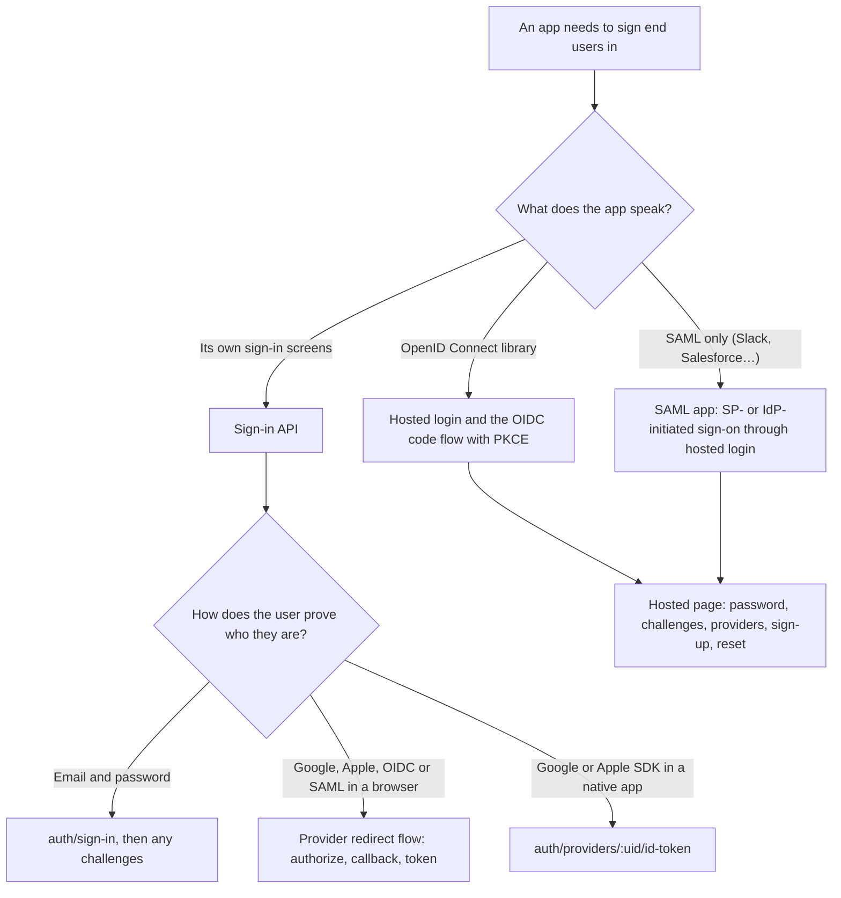

# x-identity documentation

x-identity is a user directory and authentication service. An **account** (your organisation) has
console users who manage **projects**; each project is an isolated pool of **end users** who sign in
to your apps. A project can act as an OpenID Connect provider and a SAML identity provider, and can
itself trust Google, Apple, OpenID Connect and SAML providers.

## Guides

| Document | What it covers |
| --- | --- |
| [Concepts](concepts.md) | Accounts, users, roles, projects, end users, app clients, realms, tokens |
| [Console](console.md) | Every page of the console and what it manages |
| [End-user sign-in API](end-user-auth/sign-in-api.md) | Sign-up, sign-in, challenges, tokens, password reset, invitations, the end user's own profile |
| [Multi-factor authentication](end-user-auth/mfa.md) | TOTP and HOTP, recovery codes, policies, failure handling |
| [Social and OpenID Connect providers](end-user-auth/identity-providers.md) | Google, Apple and OIDC sign-in, linking rules, native and browser flows |
| [SAML providers](end-user-auth/saml-providers.md) | Trusting a customer's SAML identity provider, domains, group sync, upstream logout |
| [Hosted login and OpenID Connect](hosted-login-and-oidc.md) | The hosted login page, the OIDC provider, single sign-on sessions |
| [Groups and app access](groups-and-access.md) | Groups, assignment-only access, the groups claim |
| [Machine-to-machine apps](machine-to-machine.md) | APIs, the client credentials grant, checking tokens, secret rotation |
| [SAML apps and the app portal](saml-apps-and-portal.md) | The project as a SAML identity provider, single logout, the portal |
| [Security model](security.md) | Enumeration resistance, lockouts, token rotation, trust rules, key management |
| [Example apps](examples.md) | Two tiny OIDC apps for trying hosted login, SSO and the portal |
| [Development](development.md) | Running locally, checks, API reference, YARD |

## Which sign-in flow?

Diagrams of each flow are in the guides: [password sign-in, sign-up and refresh](end-user-auth/sign-in-api.md),
[provider sign-in and linking](end-user-auth/identity-providers.md),
[SAML providers](end-user-auth/saml-providers.md), [hosted login and SSO](hosted-login-and-oidc.md)
and [SAML apps and single logout](saml-apps-and-portal.md).

The HTTP API reference is generated from the request specs into
[`backend/openapi/public_api.yaml`](../backend/openapi/public_api.yaml) (see [Development](development.md)).

## Features at a glance

### Accounts and the console

- Self-service account sign-up; each account has an alias (`/acme/sign-in`) and is fully isolated.
- Console users with account roles (owner, admin, member), invitations, and per-project roles
  (admin, developer, viewer).
- Console sign-in with email and password, email verification, password reset, email change,
  TOTP or HOTP MFA with recovery codes.
- Separate authentication settings for console users and for each project.
- Audit logs for the account and for each project.

### End users (per project)

- A sign-in API for your own UI: sign-up with email confirmation, sign-in, challenges (MFA code,
  expired password, MFA setup), refresh with rotation, sign-out, forgot password, invitations.
- Admin-created end users, invitations, disabling, MFA reset, sign out everywhere.
- Custom attributes (string, number, boolean, date), optionally required, user-editable or put in
  the ID token.
- Configurable password rules, lockouts, token lifetimes, signing algorithm and key rotation.

### Federation

- Sign in with Google, Apple and any OpenID Connect provider (browser redirect or native ID tokens).
- Sign in with a customer's SAML identity provider (Okta, Entra ID, ADFS…), with email-domain
  routing, user provisioning, group sync and upstream single logout.
- Account linking by verified email, with protection against pre-registered accounts.

### Hosted login and standards

- A hosted login page per project: sign-in with challenges, social and SAML providers, sign-up,
  password reset.
- A standard OpenID Connect provider per project: discovery, authorization code with PKCE, token,
  userinfo, revocation and logout endpoints.
- Single sign-on sessions across a project's apps.
- Machine-to-machine apps: the client credentials grant, for your own APIs with their own scopes.
- A SAML 2.0 identity provider per project: SP- and IdP-initiated sign-on, signed assertions,
  attribute mapping, single logout, certificate rotation.
- An app portal listing each user's apps.

### Access control

- Groups, including groups new users join automatically.
- Assignment-only app access, enforced at sign-in, refresh and single sign-on.
- A `groups` claim and SAML groups attribute.

### Tools

- A test sign-in page in the console that signs end users in through the public API or hosted login
  and decodes the tokens.
