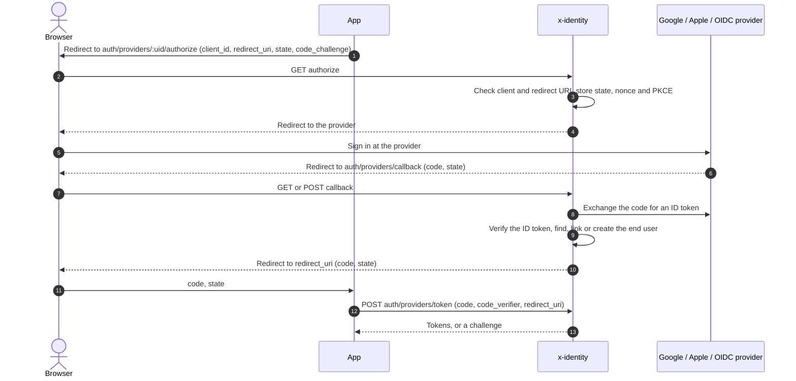
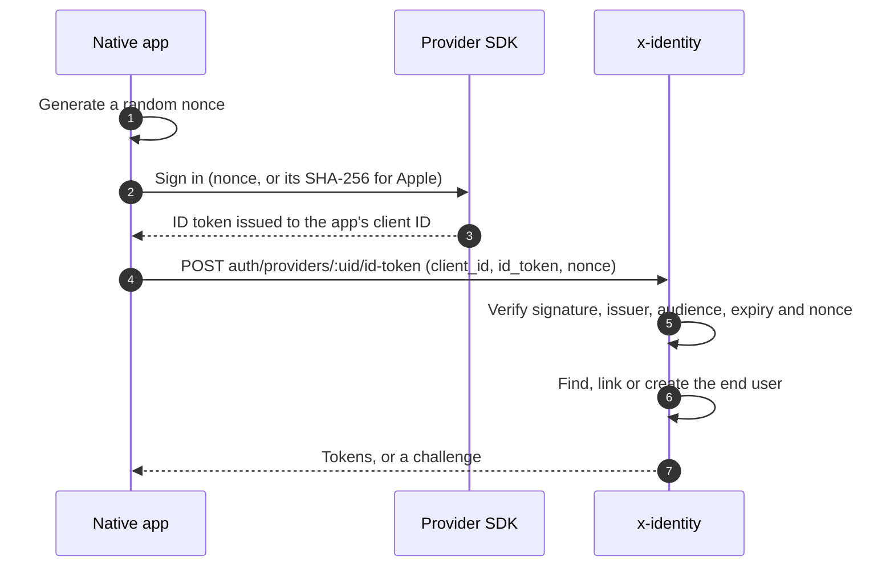
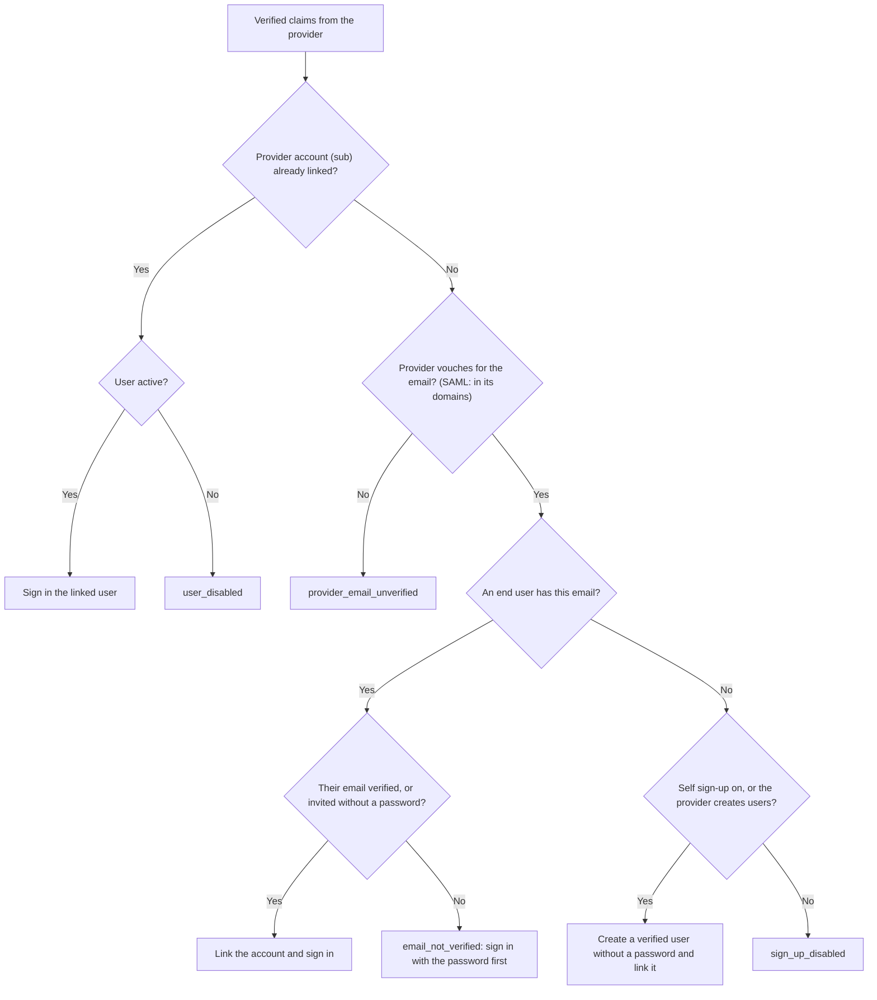

# Social and OpenID Connect providers

End users can sign in with **Google**, **Apple**, or any **OpenID Connect** provider configured on
the project's **Sign-in providers** page. (Customer SAML identity providers are covered in
[SAML providers](saml-providers.md).)

## Setting up a provider

| Kind | Settings |
| --- | --- |
| Google | Client ID and secret from Google Cloud. |
| Apple | Services ID, team ID, key ID and the `.p8` private key. The client secret is generated per request as a short-lived ES256 JWT. Apple returns users with a form POST and only sends their name on the first sign-in. |
| OpenID Connect | The issuer or discovery URL (its `/.well-known/openid-configuration` is loaded when saved, and its issuer must match), client ID, secret and scopes (must include `openid`). |

Secrets are encrypted and write-only: the API only says whether one is set, and leaving a secret
blank on update keeps the current one. **Native app client IDs** (e.g. iOS and Android client IDs,
or an iOS bundle ID for Apple) let native apps send ID tokens issued to them.

Register the project's **callback URL**, `…/auth/providers/callback`, as the redirect URI at the
provider. Providers can be disabled (no new sign-ins, links kept) or removed (links deleted).

## Browser redirect flow

For apps with their own UI. The app's redirect URI must be registered on its app client, and PKCE
(S256) is required.

1. Send the browser to `GET auth/providers/:uid/authorize` with `client_id`, `redirect_uri`,
   `state`, `code_challenge` and `code_challenge_method=S256`. The available providers are listed
   by `GET auth/providers` (for drawing buttons).
2. x-identity sends the user to the provider (with its own PKCE where supported, and a nonce),
   which returns them to the callback.
3. The browser is redirected to the app's `redirect_uri` with `code` and `state`, or with `error`,
   `error_description` and `state`.
4. The app calls `POST auth/providers/token` with `client_id` (and `client_secret` for confidential
   clients), `code`, `code_verifier` and the same `redirect_uri`. The response is the same as
   password sign-in: tokens or a challenge. Codes last one minute and work once.

The hosted login page uses the same flow internally.

## Native flow

Mobile apps using Google Sign-In or Sign in with Apple send the provider's ID token:
`POST auth/providers/:uid/id-token` with `client_id`, `id_token`, `nonce` (the raw nonce the app
generated; for Apple, the value before hashing) and optionally `name` (Apple only sends it once).

## Verifying ID tokens

ID tokens are checked against the provider's published keys (cached for an hour, refetched once a
minute at most when an unknown key appears), the issuer, the audience (client ID or a native app
client ID), expiry and the nonce. Provider requests only go to https URLs that resolve to public
addresses (see [Security](../security.md#outgoing-requests)).

## Who the user is

In order:

1. **A known provider account** (the provider's `sub`) signs in its linked end user.
2. Otherwise the provider must say the **email is verified**, or sign-in is refused
   (`provider_email_unverified`), whether or not a user has that email.
3. **An existing user with that email** is linked if their email is verified, or if they were
   invited and have no password yet (their email becomes verified). A user with a password but an
   unverified email is refused (`email_not_verified`): otherwise someone could pre-register a
   victim's address and keep access after the victim signs in with Google.
4. **No matching user**: one is created, verified and without a password, if the project allows
   self sign-up or the provider has **Create users on first sign-in** on. Otherwise
   `sign_up_disabled`.

A user can link one account per provider (`identity_conflict` otherwise). Disabled users are refused
(`user_disabled`). The project's MFA requirement, app assignments and sign-in auditing apply as
for password sign-in; `amr` is `["fed"]`, plus `otp` after an MFA code. Password expiry doesn't
apply to provider sign-ins.

## Managing linked accounts

End users list and unlink their providers with `GET me/identities` and `DELETE me/identities/:uid`;
admins do the same on the end user in the console. The last way to sign in (a user's only identity
when they have no password) can't be removed (`last_sign_in_method`). Users without a password can
add one through password reset.
