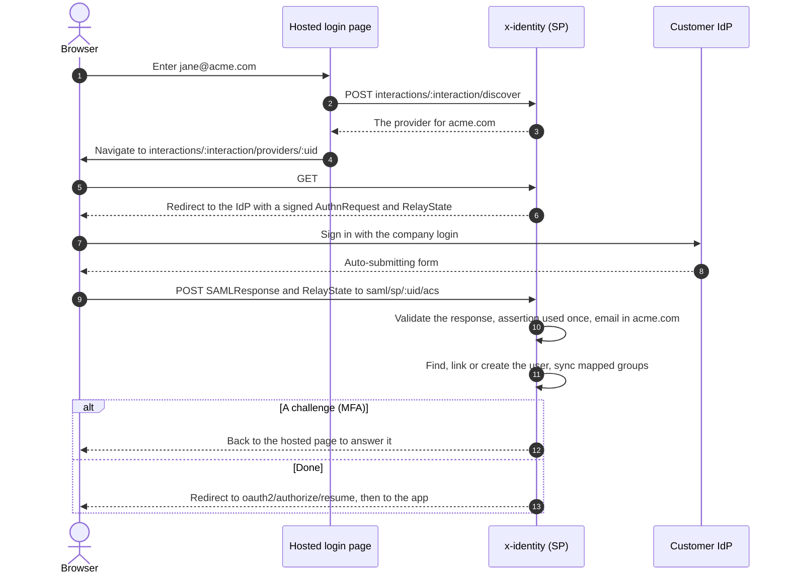
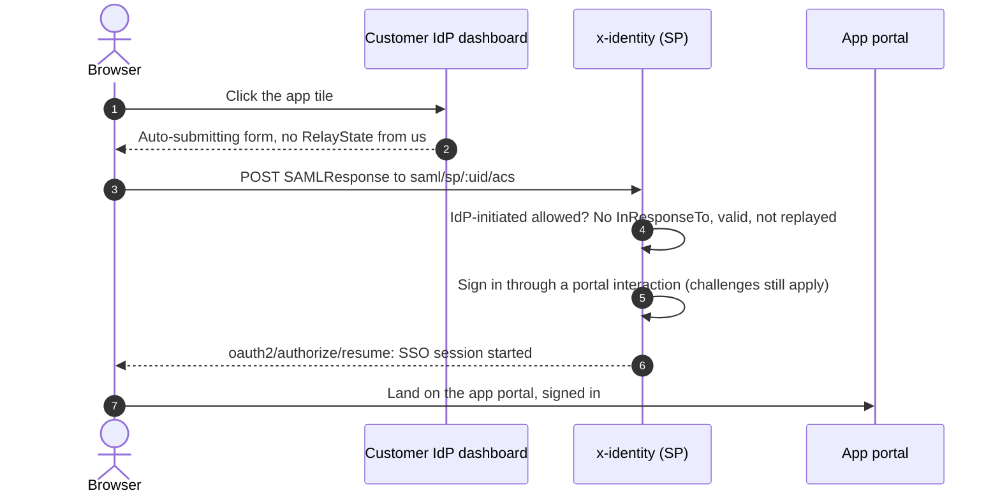
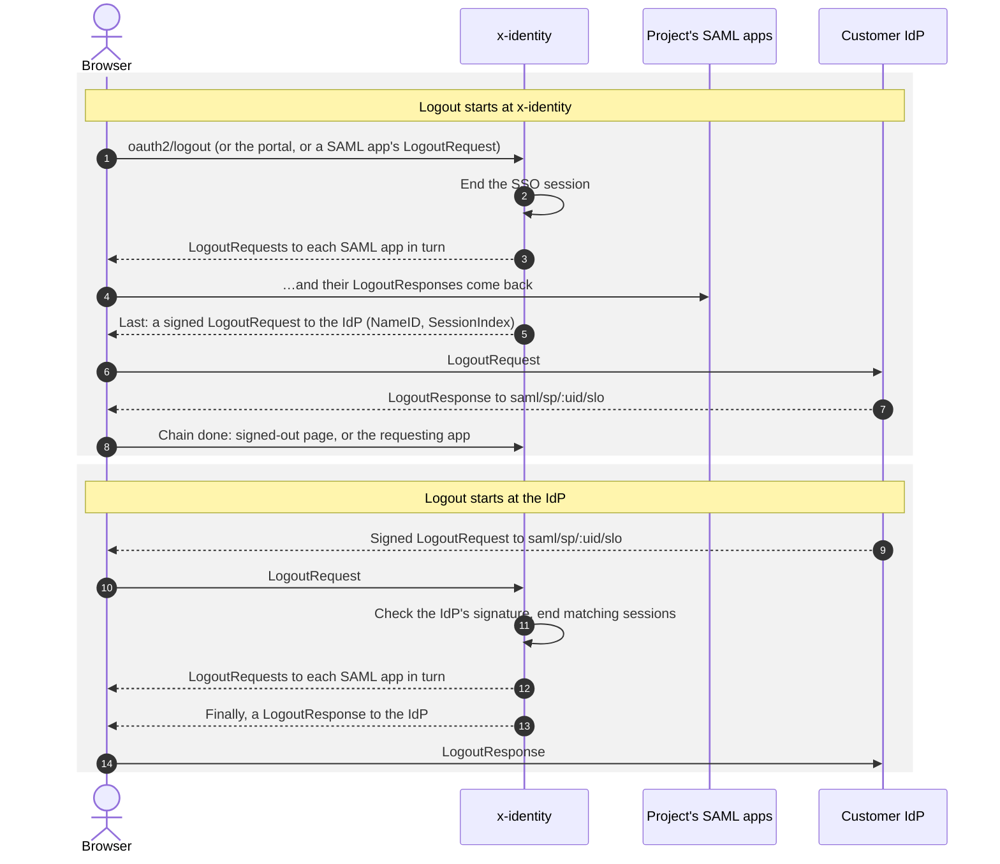

# SAML providers

A project can trust a customer's own **SAML 2.0 identity provider** (Okta, Entra ID, Google
Workspace, ADFS…), so that company's staff sign in to your app through their company login. The
project is the **service provider** (SP).

## Setting up

On **Sign-in providers**, add **SAML 2.0 (a company's identity provider)**. Fill it in from the
IdP's metadata (URL or pasted XML) or by hand:

| Setting | Notes |
| --- | --- |
| Identity provider entity ID | The IdP's issuer. |
| Sign-on URL | HTTP-Redirect binding. |
| Logout URL | Optional; enables single logout with the IdP. |
| Signing certificates | PEM; up to 5, so the IdP can rotate. |
| Email domains | The domains the IdP is trusted for, e.g. `acme.com`. Each domain belongs to one provider per project. |
| NameID to request | email, persistent or unspecified. Transient NameIDs are refused: the ID has to stay the same across sign-ins. |
| Email / name / groups attributes | Attribute names in the assertion. An empty email attribute uses the NameID. |
| Group mappings | IdP group values mapped to project groups. |
| Create users on first sign-in | Creates users even when self sign-up is off. The console turns it on for new SAML providers. |
| Allow sign-in started from the identity provider | IdP-initiated sign-in. Off by default. |

Then give the customer's IdP admin the **SP details** (shown on the provider's row):

- metadata URL, which is also the entity ID: `…/saml/sp/:provider_uid/metadata`
- assertion consumer service (ACS) URL: `…/saml/sp/:provider_uid/acs` (HTTP-POST)
- single logout URL: `…/saml/sp/:provider_uid/slo`

AuthnRequests are signed with the project's SAML certificate (see
[SAML apps](../saml-apps-and-portal.md#signing-certificates)); the SP metadata publishes it.

## Signing in

The sign-in starts from the hosted login page or from the API redirect flow, exactly like other
providers (`GET auth/providers/:uid/authorize`). x-identity sends a signed AuthnRequest with a
RelayState; the IdP posts the SAML Response to the ACS URL.

Responses are verified with ruby-saml's service provider checks: the signature against the
provider's certificates, issuer, audience, destination, recipient, time window (with a minute of
clock drift) and `InResponseTo`. Each assertion ID is accepted once (`invalid_saml_response`
otherwise).

### Email trust

SAML doesn't say whether an email is verified, so an email counts as verified **only if it's in one
of the provider's domains**. Other emails are refused, so a misconfigured or malicious IdP can't
sign in as someone else's address. Linking to existing users then follows the same rules as for
[other providers](identity-providers.md#who-the-user-is).

### Group sync

When a groups attribute and mappings are set, the user's membership of every **mapped** project
group is set to match the IdP at each sign-in: added when the IdP sends the mapped value, removed
when it doesn't. Groups that aren't mapped are left alone. Changes are audited
(`end_user.groups_synced`).

## Home realm discovery

When a project has SAML providers with domains, the hosted login page asks for the email first.
An email at a provider's domain goes straight to that IdP; anyone else is asked for their password.
The page asks the server (`POST oauth2/interactions/:interaction/discover`), so the list of domains,
and with it the project's customers, is never published. SAML providers with domains don't get a
button; those without domains do.

## IdP-initiated sign-in

When allowed, users can start from their company dashboard. The unsolicited response must not carry
an `InResponseTo`; it signs the user in through hosted login (so MFA and assignment checks still
apply) and lands them on the [app portal](../saml-apps-and-portal.md#the-app-portal). Leave it off
unless someone needs it: unsolicited responses are easier to replay or inject.

## Single logout with the IdP

- Logging out (hosted logout, the portal, or a SAML app's single logout) logs out of the project's
  SAML apps first, then sends a signed LogoutRequest to the IdP the session signed in with. The
  IdP's LogoutResponse returns to the SP logout URL and the chain finishes.
- A LogoutRequest from the IdP must be signed by one of its certificates. It ends the matching
  sessions (by NameID and SessionIndex), logs out of the project's SAML apps, and gets a
  LogoutResponse.

The API redirect flow has no browser session, so upstream logout only applies to hosted sign-ins.
