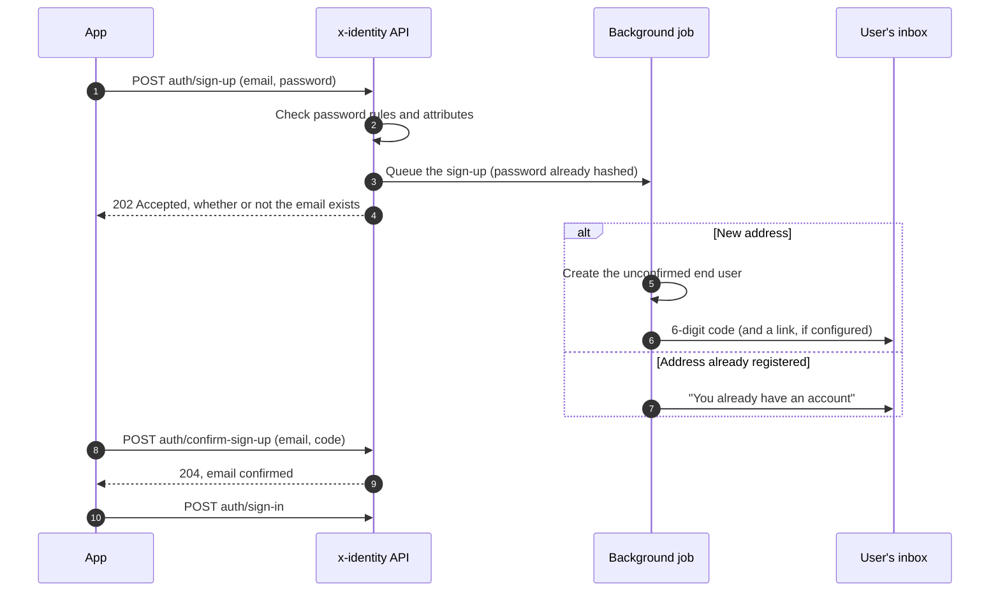
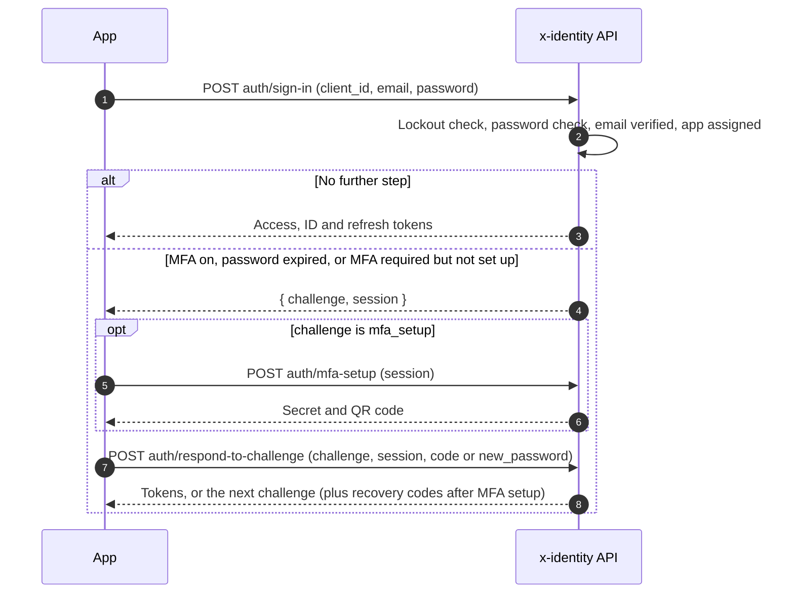

# End-user sign-in API

Use this API when your app has its own sign-in screens. (To use a ready-made page and any OpenID
Connect library instead, see [Hosted login and OpenID Connect](../hosted-login-and-oidc.md).)

All paths below are relative to the project's issuer,
`/v1/accounts/:account_uid/projects/:project_uid`. Request bodies are JSON and reject unknown fields.

## The app client

Every request under `auth/` names its **app client** with `client_id`. Confidential clients also
send `client_secret`; public clients must not. Unknown, disabled or wrongly authenticated clients
get `401 invalid_client`.

Browsers can only call the API from an origin listed on an enabled app client (or the console's own
origin).

## Sign-up and email confirmation

| Endpoint | Body | Result |
| --- | --- | --- |
| `POST auth/sign-up` | `email`, `password`, optional `name` and `custom_attributes` | `202`, always |
| `POST auth/confirm-sign-up` | `email` and `code`, or `token` from the email's link | `204` |
| `POST auth/resend-confirmation` | `email` | `202`, always |



Sign-up checks the password against the project's rules and validates custom attributes straight
away (`422`), but whether the email is already registered is decided in a background job. A new
address gets a 6-digit code (and a link, if the project has a confirm sign-up page configured); an
address that already has an account gets an "you already have an account" email instead. The
response is the same either way, so sign-up never reveals who is registered.

Self sign-up can be turned off per project (`403 sign_up_disabled`).

## Sign-in

`POST auth/sign-in` with `email` and `password` returns either tokens:

```json
{ "access_token": "…", "id_token": "…", "refresh_token": "…", "token_type": "Bearer", "expires_in": 900 }
```

or a **challenge** to answer:

```json
{ "challenge": "otp", "session": "…" }
```

Errors: `401 invalid_credentials` (wrong email or password, or a disabled user, without saying
which), `403 email_not_verified` (when the project requires verification), `403 app_access_denied`
(the user isn't assigned to this app client), `429 too_many_attempts` (locked out).

### Challenges

Answer with `POST auth/respond-to-challenge` and `challenge`, `session`, plus:

| Challenge | When | Answer with |
| --- | --- | --- |
| `otp` | The user has MFA on (and the project's requirement isn't `off`) | `code`: a one-time or recovery code |
| `new_password` | The password is older than the project's maximum age | `new_password` |
| `mfa_setup` | The project requires MFA and the user hasn't set it up | `code` from the new authenticator; first call `POST auth/mfa-setup` with `session` to get the secret and QR code |



The response is again tokens or another challenge. After `mfa_setup`, it also includes
`recovery_codes`, shown to the user once. A session lasts 5 minutes and survives wrong answers
(which count towards lockout and MFA failure limits); expired or used sessions get
`401 invalid_challenge`.

## Tokens

| Endpoint | Body | Result |
| --- | --- | --- |
| `POST auth/refresh` | `refresh_token` | New access, ID and refresh tokens |
| `POST auth/sign-out` | `refresh_token` | `204`; the session is revoked |
| `GET .well-known/jwks.json` | | The keys to verify tokens with |

Refresh tokens rotate: each one works once. Presenting a used one revokes the whole session (it's
a sign the token was stolen).

```mermaid
sequenceDiagram
    autonumber
    participant App
    participant Attacker
    participant API as x-identity API
    App->>API: POST auth/refresh (refresh token R1)
    API-->>App: New tokens with refresh token R2 (R1 is now used)
    Attacker->>API: POST auth/refresh (stolen R1)
    API->>API: R1 was already used: revoke the whole session family, audit it
    API-->>Attacker: 401 invalid_token
    App->>API: POST auth/refresh (R2)
    API-->>App: 401 invalid_token, the user signs in again
``` Refreshing fails with `session_expired` after the session lifetime or
idle timeout, `mfa_required` if the project now requires MFA and the session didn't use it, and
`app_access_denied` if the user lost access to the app.

Verify access tokens by signature (JWKS), `iss` (the project's issuer), `aud` (your client's uid),
`exp`, and `token_use: "access"`.

## Password reset

| Endpoint | Body | Result |
| --- | --- | --- |
| `POST auth/forgot-password` | `email` | `202`, always |
| `POST auth/confirm-forgot-password` | `password`, and `email` + `code` or `token` | `204`; every session is signed out |

## Invitations

Admins can create end users without a password and invite them. The invitation email contains a
code and, when the project has an accept invitation page, a link.
`POST auth/accept-invitation` takes `password`, and `email` + `code` or `token`.

## Email codes and links

Emails carry a 6-digit code, and a link when the project's corresponding URL template is set (on
the project overview, e.g. `https://shop.example.com/confirm?token={token}`). Codes expire
(confirmation: 24 hours, password reset and email change: 1 hour, invitation: 7 days) and are
limited per code, per email and per code value; see [Security](../security.md#email-codes).

## The signed-in user

With the access token as `Authorization: Bearer …`:

| Endpoint | Purpose |
| --- | --- |
| `GET me`, `PATCH me` | Profile; `name` and user-editable custom attributes |
| `PUT me/password` | `current_password`, `new_password`; other sessions are signed out |
| `POST me/email` | `new_email`, `current_password`, and `otp_code` when MFA is on; a code goes to the new address |
| `POST me/email/confirm` | `code`; other sessions are signed out |
| `POST me/otp`, `POST me/otp/confirm`, `DELETE me/otp` | Set up, confirm and turn off MFA (see [MFA](mfa.md)) |
| `POST me/recovery-codes` | New recovery codes, with a current `code` |
| `GET me/identities`, `DELETE me/identities/:uid` | Linked sign-in providers (see [providers](identity-providers.md)) |

## Admin actions on end users

From the console or the management API (`end-users/…`): create (with or without an invitation),
update name, attributes and status, disable (signs the user out everywhere), reset MFA, sign out
everywhere, resend the invitation, list and unlink identities, delete.
