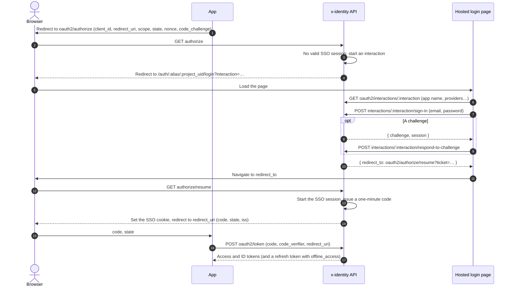
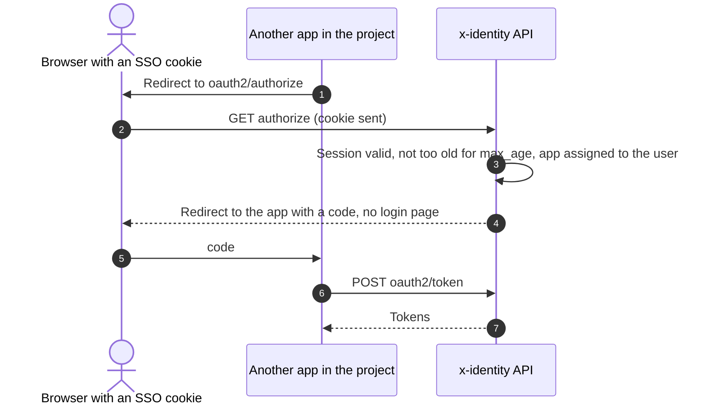

# Hosted login and OpenID Connect

Every project is a standard **OpenID Connect provider** with a **hosted login page**, so an app can
sign users in with any OIDC library instead of building screens on the
[sign-in API](end-user-auth/sign-in-api.md).

## Using it from an app

1. Create an app client, add the app's callback URL to its **redirect URIs**, and assign it to the
   users or groups who may use it.
2. Point your OIDC library at the project's issuer (shown on the project overview). Discovery is at
   `{issuer}/.well-known/openid-configuration`.
3. Use the authorization code flow with PKCE (S256), which is required for every client.

## Endpoints

All under the project's issuer:

| Endpoint | Notes |
| --- | --- |
| `GET .well-known/openid-configuration` | Discovery. |
| `GET .well-known/jwks.json` | Signing keys. |
| `GET oauth2/authorize` | `response_type=code` only. `scope` must include `openid`. Supports `state`, `nonce`, `prompt=none\|login`, `max_age`, `login_hint`. The response carries `iss` (RFC 9207). |
| `POST oauth2/token` | `authorization_code` (with `code_verifier` and the same `redirect_uri`) and `refresh_token` grants. Clients authenticate with `client_secret_basic`, `client_secret_post`, or just `client_id` when public. |
| `GET\|POST oauth2/userinfo` | With an access token. |
| `POST oauth2/revoke` | RFC 7009; revokes refresh tokens. Always `200`. |
| `GET\|POST oauth2/logout` | RP-initiated logout; `post_logout_redirect_uri` must be registered on the client (identified by `client_id` or `id_token_hint`). |

Scopes: `openid` (required), `profile`, `email`, `groups` (adds the user's group names to the ID
token and userinfo) and `offline_access` (issues a refresh token; without it, none is issued).
The ID token echoes the `nonce`. Errors on these endpoints use the OAuth format
(`error`, `error_description`).

Authorization errors go back to the app's redirect URI once the client and redirect URI are known
to be valid (`invalid_request`, `invalid_scope`, `unsupported_response_type`, `login_required`,
`access_denied` for unassigned users). Unknown clients and unregistered redirect URIs are shown on
the hosted error page instead, so the browser is never sent somewhere unregistered.

## The hosted login page

Lives in the web app at `/auth/:alias/:project_uid/login`. It offers:

- email and password sign-in, with the `otp`, `new_password` and `mfa_setup` challenges and
  recovery codes,
- buttons for the project's providers, and home realm discovery for
  [SAML providers](end-user-auth/saml-providers.md#home-realm-discovery),
- sign-up with the emailed code (when self sign-up is on),
- password reset.

It works through an **interaction** (30 minutes): a reference to the pending authorization that
stands in for the app client. The page never sees a client secret and never receives tokens; when
sign-in finishes it only learns where to send the browser next (`…/oauth2/authorize/resume`), where
the backend starts the session and redirects to the app with a code. MFA challenges started on the
hosted page can only be answered there, not through the regular API.

Other hosted pages: `/auth/:alias/:project_uid/error`, `/signed-out` and `/apps` (the
[app portal](saml-apps-and-portal.md#the-app-portal)).

## Single sign-on sessions

Signing in on the hosted page starts a **browser session**: a server-side record and an httpOnly,
SameSite=Lax cookie scoped to the project's path. While it's valid, `/oauth2/authorize` (and SAML
sign-on) for any of the project's apps answers straight away, without the login page.

- `prompt=login` and `max_age` force a new sign-in; `prompt=none` fails with `login_required`
  instead of showing the page.
- The session lasts the project's **hosted login session** setting (8 hours by default).
- It ends at logout, when the user's sessions are revoked (sign out everywhere, password reset,
  disabling), and when it expires. Logout also runs [SAML single logout](saml-apps-and-portal.md#single-logout).

In production, the hosted pages (`CONSOLE_BASE_URL`) and the API (`APP_BASE_URL`) must be on the
same site, for example one domain behind a proxy, so the cookie is sent. Locally,
`localhost` ports count as the same site.

## Testing it

The console's **Test sign-in** page has **Sign in with hosted login**: it runs the code flow with
PKCE, with the console as a public client, and shows the resulting tokens. Add the page's URL
(shown on the page) to the chosen client's redirect URIs first.
