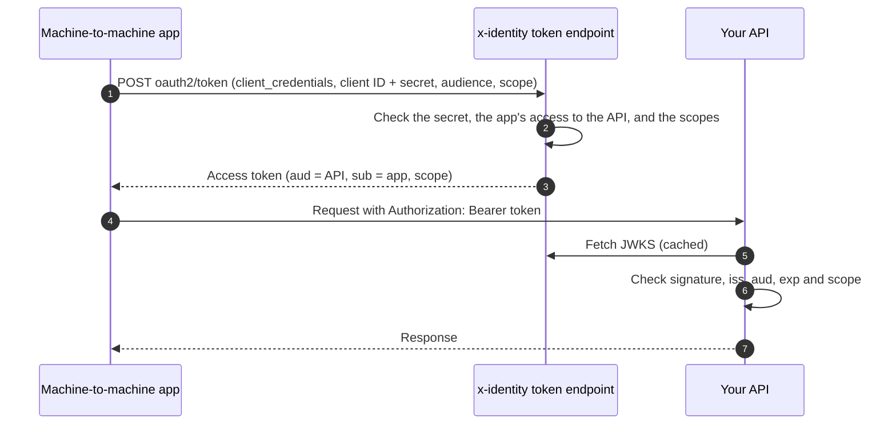

# Machine-to-machine apps

A **machine-to-machine app** is a program, such as a scheduled job, a backend service or a partner's
server, that calls your APIs as itself. No person signs in. It gets short-lived access tokens with
the OAuth 2.0 **client credentials** grant ([RFC 6749 §4.4](https://www.rfc-editor.org/rfc/rfc6749#section-4.4)).

Every other flow ends with a token for a person (`sub` is an end user). Client credentials tokens
are for the app itself: `sub` is the app's client ID, `aud` is the API the token is for, and
`scope` is what the app may do there. There's no user, refresh token or ID token.

## Setting it up

1. **Add your API** under Applications › APIs: a name, an **identifier** and its **scopes**.
   - The identifier becomes the tokens' `aud`, usually the API's URL, e.g. `https://orders.example.com`.
   - Scopes are what apps can be allowed to do, e.g. `orders:read`.
   - Each API can set its own token lifetime (5 minutes to 1 hour). The default is the project's
     access token lifetime.
2. **Add a machine-to-machine app** under Applications › Add application. Copy its client secret:
   it's shown once.
3. **Give it access** in the app's API access tab: pick the API and the scopes it may request.

## Getting a token

```bash
curl -X POST https://id.example.com/v1/accounts/acct_…/projects/proj_…/oauth2/token \
  -u 'cl_…:CLIENT_SECRET' \
  -d grant_type=client_credentials \
  -d audience=https://orders.example.com \
  -d 'scope=orders:read'
```

```json
{ "access_token": "eyJ…", "token_type": "Bearer", "expires_in": 900, "scope": "orders:read" }
```

- **Client authentication:** send the secret with HTTP Basic (`client_secret_basic`) or as
  `client_secret` in the form (`client_secret_post`).
- **`audience`** (or `resource`) names the API. It can be left out when the app has access to
  only one API.
- **`scope`** is space-separated. Without it, the token gets every scope the app was given on that API.
- **Renewal:** request a new token shortly before `expires_in` runs out. There are no refresh tokens.

| Error | When |
| --- | --- |
| `invalid_client` | Unknown or disabled app, or a wrong secret |
| `unauthorized_client` | Not a machine-to-machine app (or a machine app using another grant) |
| `invalid_request` | No `audience`, and the app can use several APIs |
| `invalid_target` | Unknown API, or one the app hasn't been given access to |
| `invalid_scope` | A scope the app wasn't given on that API |
| `slow_down` (HTTP 429) | Over the app's token requests per minute; retry after `Retry-After` seconds |



## Checking tokens in your API

Tokens are JWTs signed with the project's keys, published at
`…/projects/proj_…/.well-known/jwks.json`. Your API should check:

- **Signature:** with the key whose `kid` matches the token's header.
- **`iss`:** the project's issuer.
- **`aud`:** your API's identifier, so tokens meant for other APIs are refused.
- **`exp`:** that the token hasn't expired.
- **`scope`:** that it includes the scope the operation needs.

Other claims are `sub` and `client_id` (the app), `gty: "client-credentials"`, `token_use: "access"`,
`iat` and `jti`. Any standard JWT library does this given the JWKS URL.

x-identity's own end-user endpoints (`/me`, userinfo) never accept these tokens. Machine apps also
can't sign end users in: the sign-in API and hosted login refuse them.

## Secrets and rotation

Every confidential client, including machine-to-machine apps, can have more than one working
secret:

- **Rotate secret** issues a new secret. The previous ones keep working for the project's
  **rotation overlap**, so every server can switch over without downtime.
  - **Default:** 7 days.
  - **Where:** Authentication › Tokens & sessions › App clients.
  - **Range:** 0 to 30 days; 0 stops old secrets at once.
  - **No extensions:** rotating again never makes an older secret last longer.
- The Credentials tab lists each secret by its last four characters, with when it was created and
  last used, and whether it's active, expiring or revoked.
- **Revoke** stops an old secret at once. The only working secret can't be revoked; rotate first.

## Auditing and limits

- **Every token** issued is recorded as `app_client.token_issued` (with the API and scopes). Every
  refusal is recorded as `app_client.token_refused` (with the error). Both appear in the app's
  Activity tab and the project audit log.
- **Changes** to APIs and access are recorded as `api.*` events. Secret rotation and revocation
  are recorded as `app_client.secret_*` events.
- **Rate limits:** each app client may make a set number of token requests a minute.
  - **Project default:** 120, set in Authentication › Tokens & sessions › App clients.
  - **Per-app limit:** a machine app can set its own in its Credentials tab (10 to 10,000).
  - **Over the limit:** the response is HTTP 429 with `error: slow_down` and a `Retry-After`
    header, and the refusal is audited.
  - **Per IP:** a fixed ceiling of 1,200 token requests a minute also applies, against abuse.

Deleting an API, removing an app's access or disabling the app stops new tokens at once. Tokens
already issued keep working until they expire.
