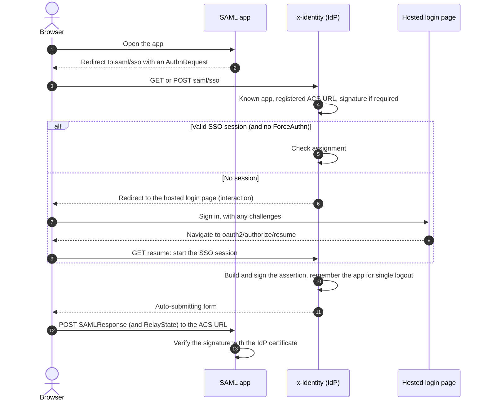
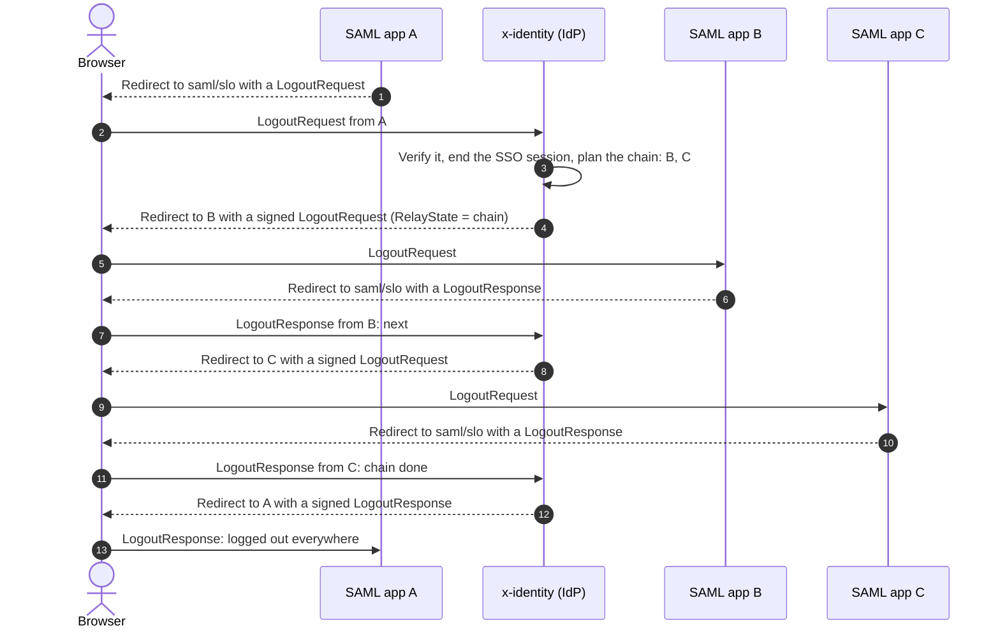
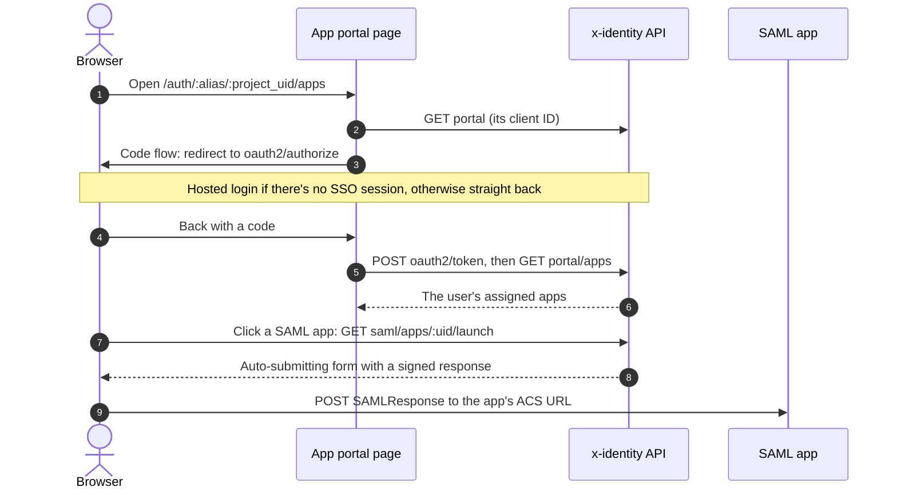

# SAML apps and the app portal

Every project is a **SAML 2.0 identity provider**, so apps that only speak SAML (Slack, Salesforce,
AWS, Zoom…) can sign the project's users in. Sign-in goes through [hosted login](hosted-login-and-oidc.md)
and its single sign-on session, so MFA, social and SAML providers, lockouts and
[assignment](groups-and-access.md) all apply.

## The identity provider

| | URL (under the project's issuer) |
| --- | --- |
| Metadata and entity ID | `saml/metadata` |
| Single sign-on | `saml/sso` (HTTP-Redirect and HTTP-POST) |
| Single logout | `saml/slo` (HTTP-Redirect and HTTP-POST) |

The **SAML apps** page shows these, with the signing certificate's fingerprint and a download.

## Adding an app

Import the app's SP metadata (URL or XML) or fill in:

| Setting | Notes |
| --- | --- |
| Entity ID | The app's issuer / audience. |
| ACS URLs | Where the app receives sign-ins (HTTP-POST). The first is used for IdP-initiated sign-in. |
| Single logout URL | Optional (HTTP-Redirect). |
| NameID | Email address, persistent (the user's uid), or unspecified (email). |
| Attributes | Names mapped to email, email_verified, name, uid, groups (one value per group) or `custom:<attribute key>`. Up to 20. |
| Signing | Sign the assertion (default), the whole response, or both. |
| Signed requests | Require the app to sign its requests; needs the app's certificate. |
| Default relay state | Sent with IdP-initiated sign-ins, e.g. the page to open. |

Then assign it to groups or users with **Access**.

## Sign-on

- **SP-initiated**: the app sends an AuthnRequest. Its issuer must be a registered, enabled app and
  its ACS URL one of the app's; only the HTTP-POST response binding is supported. `ForceAuthn`
  asks the user to sign in again; `IsPassive` gets a `NoPassive` status instead of a login page.
- **IdP-initiated**: `saml/apps/:uid/launch`, used by the app portal.

Assertions contain the NameID, a SessionIndex, audience and time conditions (5 minutes), an
authentication context (`PasswordProtectedTransport` for passwords, `https://refeds.org/profile/mfa`
after an MFA code, `unspecified` for identity provider sign-ins) and the mapped attributes. Responses are posted to the app by an auto-submitting form.

## Single logout

Each browser session remembers the SAML apps it signed in to, with their NameID and SessionIndex.
When the session ends, by a LogoutRequest from one app, hosted logout or the portal, the user is
logged out of every other app with a logout URL, one front-channel redirect at a time. Each app
answers with a LogoutResponse and the chain moves on, then ends with a LogoutResponse to the app
that asked, or at the destination URL. Sessions that signed in through an upstream SAML provider
log out there last ([details](end-user-auth/saml-providers.md#single-logout-with-the-idp)).

Outgoing logout messages use the HTTP-Redirect binding and are signed.

Hosted logout (`oauth2/logout`) and the portal's **Log out** run the same chain, without an app to
answer at the end: the browser finishes at the post-logout redirect URI or the signed-out page.

## Signing certificates

Each project signs SAML messages with its own RSA certificate (many SAML apps can't verify ES256),
created on first use and valid for 10 years. Rotation, by project admins:

1. **Add new certificate**: it's published in the metadata straight away but not used yet.
2. Give apps time to pick it up (or upload it to them), then **Start signing with it**. The old one
   is retired but stays published.
3. **Remove** the retired certificate once no app needs it.

The same certificate signs AuthnRequests to [upstream SAML providers](end-user-auth/saml-providers.md).

## The app portal

`/auth/:alias/:project_uid/apps` lists the apps a signed-in user is assigned: SAML apps, and app
clients with a **launch URL**. SAML apps open with IdP-initiated sign-in; OIDC apps open at their
launch URL. Below the apps, **Your devices** lists where the user is signed in and lets them sign
devices out. The portal link is on the project overview.

The portal is a first-party OIDC client of the project (system-managed and hidden from the app
clients list). It signs itself in with the code flow, which the single sign-on session makes
seamless, and keeps only its own access token in session storage. **Log out** ends the hosted login
session and runs single logout.
